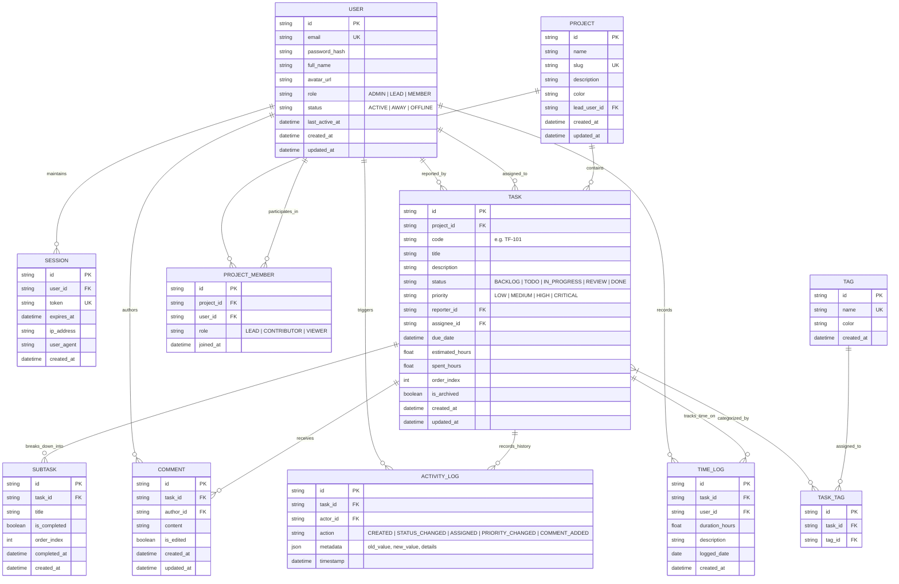

# Entity-Relationship (ER) Diagram & Database Architecture

TaskFlow utilizes a relational domain data model backed by an ACID-compliant atomic persistent storage engine in Node.js with real-time reactive event streaming via Server-Sent Events (SSE).

---

## 1. Visual Entity-Relationship Diagram (Mermaid)



---

## 2. Entity Specifications & Field Dictionary

### 2.1 `User`
Stores system accounts, credential hashes, and authorization roles.

| Field | Type | Modifiers | Description |
|---|---|---|---|
| `id` | `VARCHAR(36)` | PK, UUIDv4 | Unique user identifier |
| `email` | `VARCHAR(255)` | UNIQUE, NOT NULL | Login email address |
| `password_hash` | `VARCHAR(255)` | NOT NULL | Salted PBKDF2 / Argon2 cryptographic hash |
| `full_name` | `VARCHAR(128)` | NOT NULL | Display name |
| `avatar_url` | `VARCHAR(512)` | NULLABLE | Profile picture URL or SVG avatar seed |
| `role` | `ENUM` | NOT NULL, DEFAULT `'MEMBER'` | `'ADMIN'`, `'LEAD'`, `'MEMBER'` |
| `status` | `ENUM` | NOT NULL, DEFAULT `'ACTIVE'` | `'ACTIVE'`, `'AWAY'`, `'OFFLINE'` |
| `last_active_at`| `TIMESTAMP` | NOT NULL | Real-time presence heartbeat |
| `created_at` | `TIMESTAMP` | NOT NULL, DEFAULT `NOW()` | Registration date |
| `updated_at` | `TIMESTAMP` | NOT NULL, DEFAULT `NOW()` | Profile modification date |

### 2.2 `Task`
The central operational unit of the dashboard.

| Field | Type | Modifiers | Description |
|---|---|---|---|
| `id` | `VARCHAR(36)` | PK, UUIDv4 | Task unique identifier |
| `project_id` | `VARCHAR(36)` | FK -> `Project.id`, INDEX | Parent project |
| `code` | `VARCHAR(16)` | UNIQUE, NOT NULL | Human-readable identifier (e.g. `TF-104`) |
| `title` | `VARCHAR(256)` | NOT NULL | Task summary heading |
| `description` | `TEXT` | NULLABLE | Detailed requirements and markdown description |
| `status` | `ENUM` | NOT NULL, INDEX | `'BACKLOG'`, `'TODO'`, `'IN_PROGRESS'`, `'REVIEW'`, `'DONE'` |
| `priority` | `ENUM` | NOT NULL, INDEX | `'LOW'`, `'MEDIUM'`, `'HIGH'`, `'CRITICAL'` |
| `reporter_id` | `VARCHAR(36)` | FK -> `User.id`, NOT NULL | Creator of the task |
| `assignee_id` | `VARCHAR(36)` | FK -> `User.id`, NULLABLE | Assigned team member |
| `due_date` | `DATE` | NULLABLE, INDEX | Deadline for milestone delivery |
| `estimated_hours`| `DECIMAL(5,2)` | DEFAULT `0.00` | Target time estimate |
| `spent_hours` | `DECIMAL(5,2)` | DEFAULT `0.00` | Accumulated logged hours |
| `order_index` | `INT` | NOT NULL, DEFAULT `0` | Kanban board column ordering |
| `is_archived` | `BOOLEAN` | NOT NULL, DEFAULT `FALSE` | Soft-deletion flag |
| `created_at` | `TIMESTAMP` | NOT NULL, DEFAULT `NOW()` | Record creation timestamp |
| `updated_at` | `TIMESTAMP` | NOT NULL, DEFAULT `NOW()` | Record modification timestamp |

### 2.3 `Subtask`
Checklist breakdown items associated with a task.

| Field | Type | Modifiers | Description |
|---|---|---|---|
| `id` | `VARCHAR(36)` | PK, UUIDv4 | Unique subtask ID |
| `task_id` | `VARCHAR(36)` | FK -> `Task.id`, INDEX | Parent task |
| `title` | `VARCHAR(256)` | NOT NULL | Item description |
| `is_completed` | `BOOLEAN` | NOT NULL, DEFAULT `FALSE` | Completion status |
| `order_index` | `INT` | NOT NULL, DEFAULT `0` | Sort position |
| `completed_at` | `TIMESTAMP` | NULLABLE | Date completed |

### 2.4 `Comment`
Discussion stream for team collaboration on specific tasks.

| Field | Type | Modifiers | Description |
|---|---|---|---|
| `id` | `VARCHAR(36)` | PK, UUIDv4 | Comment identifier |
| `task_id` | `VARCHAR(36)` | FK -> `Task.id`, INDEX | Target task |
| `author_id` | `VARCHAR(36)` | FK -> `User.id`, INDEX | Author reference |
| `content` | `TEXT` | NOT NULL | Markdown commentary body |
| `is_edited` | `BOOLEAN` | NOT NULL, DEFAULT `FALSE` | Indicates post-creation modifications |
| `created_at` | `TIMESTAMP` | NOT NULL, DEFAULT `NOW()` | Submission timestamp |
| `updated_at` | `TIMESTAMP` | NOT NULL, DEFAULT `NOW()` | Last edited timestamp |

### 2.5 `ActivityLog` (Audit Trail)
Immutable ledger recording all lifecycle events and state transitions.

| Field | Type | Modifiers | Description |
|---|---|---|---|
| `id` | `VARCHAR(36)` | PK, UUIDv4 | Audit log record ID |
| `task_id` | `VARCHAR(36)` | FK -> `Task.id`, INDEX | Target task |
| `actor_id` | `VARCHAR(36)` | FK -> `User.id`, INDEX | User initiating action |
| `action` | `VARCHAR(64)` | NOT NULL | Event classification |
| `metadata` | `JSON` | NOT NULL | Delta details `{ previousStatus, newStatus, field, change }` |
| `timestamp` | `TIMESTAMP` | NOT NULL, DEFAULT `NOW()` | Instant event occurred |

---

## 3. Real-Time Streaming & Replication Pipeline

```
  +------------------+         REST API Mutation
  | React 19 Client  | -----------------------------> +---------------------+
  |   (Dashboard)    |                                |  Express.js Server  |
  +------------------+                                +----------+----------+
          ^                                                      |
          | Server-Sent Events (SSE)                             | Writes / Mutates
          | stream: /api/realtime/stream                         v
          |                                           +---------------------+
          +------------------------------------------ |  Persistent Engine  |
                       Real-time Broadcast            |  (data/db.json)     |
                      [task:updated, comment:new]     +---------------------+
```

1. **Write Operations**: Clients execute standard REST API calls (`POST`, `PATCH`, `DELETE`) with Bearer tokens.
2. **Transaction & Commit**: The server updates the in-memory state and atomically commits serializations to `data/db.json`.
3. **Event Notification**: Upon write success, an internal `EventEmitter` broadcasts an event payload containing `type`, `entity`, and `timestamp`.
4. **SSE Fan-Out**: Active SSE subscriber channels receive the event frame and dispatch state updates to all connected browser sessions without requiring manual page reload.
